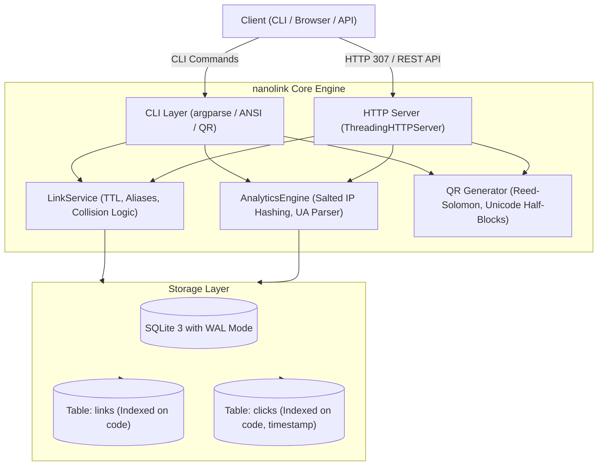
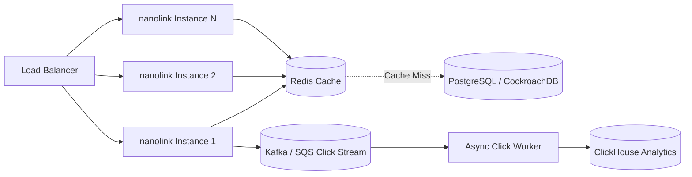

# nanolink ⚡

[]()
[](LICENSE)
[](https://www.python.org/)
[]()

> High-performance URL shortener & analytics engine featuring a rich CLI, embedded HTTP redirect microservice, and interactive dark-mode dashboard. **Pure Python standard library with zero third-party dependencies.**

Built to demonstrate production engineering fundamentals, system design trade-offs, and clean architectural design for technical interviews.

---

## 📑 Table of Contents
- [Architecture & System Design](#-architecture--system-design)
- [Key Features](#-key-features)
- [Quick Start](#-quick-start)
- [CLI Reference](#-cli-reference)
- [REST API Reference](#-rest-api-reference)
- [System Design & Interview Deep Dive](#-system-design--interview-deep-dive)
- [Database Schema & Indexing](#-database-schema--indexing)
- [Scaling Roadmap](#-scaling-roadmap)
- [Running Tests](#-running-tests)
- [License](#-license)

---

## 🏗 Architecture & System Design



---

## ✨ Key Features

- **Zero External Dependencies**: Runs instantly on standard Python (3.10 - 3.14+) without `pip install` hurdles.
- **Base62 ID Encoding**: Compact 7-character URLs yielding **3.52 trillion** distinct permutations.
- **Collision Resolution Engine**: Multi-stage SHA-256 deterministic hashing with salt-based collision retry fallback.
- **HTTP 307 Temporary Redirection**: Preserves HTTP request verbs while guaranteeing that client/browser caching doesn't skew click counts.
- **Privacy-Preserving Analytics (GDPR-Compliant)**: Daily-salted SHA-256 IP hashing counts unique visitors without storing personally identifiable IP addresses.
- **Pure-Python QR Matrix Engine**: ISO/IEC 18004 compliant Version 1–4 QR generator rendering directly in ANSI terminal text, ASCII, or vector SVG.
- **Embedded Web Dashboard**: Responsive dark-mode single-page application served directly from the embedded HTTP engine.
- **SQLite with WAL Mode**: High concurrency read performance with foreign key cascading deletes and atomic counters.

---

## 🚀 Quick Start

### 1. Installation
Clone the repository:
```bash
git clone https://github.com/yashuraghuvanshi4-pixel/nanolink.git
cd nanolink
```

Optional: Install locally as a system command:
```bash
pip install -e .
```

### 2. Basic Usage via CLI

Shorten a URL:
```bash
python3 -m nanolink.cli shorten https://github.com/yashuraghuvanshi4-pixel
```

Shorten with a custom alias and terminal QR code:
```bash
python3 -m nanolink.cli shorten https://news.ycombinator.com --alias yc --qr
```

Inspect analytics:
```bash
python3 -m nanolink.cli stats yc
```

Launch the HTTP server and web dashboard:
```bash
python3 -m nanolink.cli serve --port 8000
```
Open [http://localhost:8000](http://localhost:8000) in your browser to view the interactive dashboard.

---

## 💻 CLI Reference

| Command | Usage | Description |
| :--- | :--- | :--- |
| `shorten` | `nanolink shorten <url> [-a alias] [--ttl seconds] [--qr]` | Shorten a target destination URL |
| `resolve` | `nanolink resolve <code>` | Query destination and metadata for a short code |
| `stats` | `nanolink stats <code> [--json]` | View click metrics, daily charts, referrers |
| `list` | `nanolink list [-n limit] [--offset n]` | List all shortened links in the database |
| `qr` | `nanolink qr <code> [--svg output.svg]` | Print ANSI QR code or export as SVG |
| `delete` | `nanolink delete <code> [-f]` | Delete a link and cascade its click records |
| `serve` | `nanolink serve [-p port] [-H host]` | Start HTTP redirect server & REST microservice |

### Examples

**Shorten with Time-To-Live (expires in 1 hour):**
```bash
python3 -m nanolink.cli shorten https://example.com/one-time --ttl 3600
```

**JSON Output for Piping to jq:**
```bash
python3 -m nanolink.cli stats yc --json | jq '.total_clicks'
```

---

## 🌐 REST API Reference

### 1. Shorten URL
`POST /api/shorten`

**Request Body:**
```json
{
  "url": "https://en.wikipedia.org/wiki/Computer_science",
  "alias": "cs-wiki",
  "ttl_seconds": 86400,
  "max_clicks": 500
}
```

**Response (`201 Created`):**
```json
{
  "code": "cs-wiki",
  "target_url": "https://en.wikipedia.org/wiki/Computer_science",
  "short_url": "http://localhost:8000/cs-wiki",
  "created_at": "2026-10-27T14:30:00+00:00",
  "expires_at": "2026-10-28T14:30:00+00:00",
  "click_count": 0,
  "is_expired": false
}
```

### 2. Redirect to Target
`GET /{code}`

- Returns `307 Temporary Redirect` with `Location: <target_url>`
- Increments click counter and asynchronously records visitor telemetry.
- Returns `404 Not Found` if code doesn't exist, or `410 Gone` if expired.

### 3. Retrieve Link Analytics
`GET /api/stats/{code}`

**Response (`200 OK`):**
```json
{
  "total_clicks": 42,
  "unique_visitors": 28,
  "clicks_by_date": {
    "2026-10-26": 18,
    "2026-10-27": 24
  },
  "top_referrers": [
    ["twitter.com", 19],
    ["Direct / None", 14],
    ["github.com", 9]
  ],
  "browsers": {
    "Chrome": 26,
    "Safari": 12,
    "Firefox": 4
  },
  "devices": {
    "desktop": 30,
    "mobile": 12
  }
}
```

### 4. Fetch QR Code SVG
`GET /api/qr/{code}`
- Returns `image/svg+xml` representation of the QR code.

---

## 🧠 System Design & Interview Deep Dive

### 1. Base62 ID Generation vs Hash-Based Generation
- **Base62 ($[0-9a-zA-Z]$)**:
  $62^7 \approx 3.52 \times 10^{12}$ combinations.
  Using an auto-incrementing 64-bit integer ID converted to Base62 ensures zero collisions and maximum density. However, sequential IDs reveal creation volume to competitors (the *German Tank Problem*).
- **nanolink Hybrid Strategy**:
  We hash `(url + collision_salt)` using SHA-256 and encode the top 48 bits into Base62. If an alias collision occurs with a differing target URL, an incremental salt is appended. This provides deterministic IDs for identical URLs without exposing database sequence IDs.

### 2. Why HTTP 307 Instead of 301 or 302?
- **`301 Moved Permanently`**:
  Browsers aggressively cache 301 redirects to local disk. Subsequent user clicks never hit the server, completely blinding your analytics engine.
- **`302 Found`**:
  Historically ambiguous; some legacy HTTP/1.0 clients would rewrite `POST` requests to `GET` during redirection.
- **`307 Temporary Redirect`**:
  Explicitly preserves the original request method and strictly prohibits client-side caching when paired with `Cache-Control: no-cache, no-store`. Every click hits the server for real-time analytics.

### 3. Privacy-Preserving Telemetry (GDPR / CCPA)
Instead of storing raw IP addresses, nanolink passes incoming IPs through:
$$\text{ip\_hash} = \text{SHA256}(\text{client\_ip} + \text{daily\_salt} + \text{app\_secret})[0..16]$$
Because the salt rotates daily:
1. Daily unique visitors can be counted with mathematical precision.
2. Cross-day profiling and surveillance are cryptographically impossible.
3. No raw PII (Personally Identifiable Information) touches disk.

---

## 🗄 Database Schema & Indexing

```sql
CREATE TABLE links (
    id INTEGER PRIMARY KEY AUTOINCREMENT,
    code TEXT NOT NULL UNIQUE,
    target_url TEXT NOT NULL,
    title TEXT,
    created_at TEXT NOT NULL,
    expires_at TEXT,
    max_clicks INTEGER,
    click_count INTEGER DEFAULT 0,
    is_active INTEGER DEFAULT 1
);
CREATE INDEX idx_links_code ON links(code);
CREATE INDEX idx_links_created ON links(created_at DESC);

CREATE TABLE clicks (
    id INTEGER PRIMARY KEY AUTOINCREMENT,
    link_code TEXT NOT NULL,
    timestamp TEXT NOT NULL,
    ip_hash TEXT NOT NULL,
    user_agent TEXT,
    browser TEXT,
    os TEXT,
    device_type TEXT,
    referer TEXT,
    referer_domain TEXT,
    country TEXT,
    FOREIGN KEY (link_code) REFERENCES links(code) ON DELETE CASCADE
);
CREATE INDEX idx_clicks_code_ts ON clicks(link_code, timestamp DESC);
CREATE INDEX idx_clicks_ip ON clicks(ip_hash);
```

- **Index on `links(code)`**: Ensures $O(1)$ B-tree lookup latency on every redirect.
- **Composite Index on `clicks(link_code, timestamp DESC)`**: Enables rapid range queries for recent click telemetry and charting without table scans.
- **Write-Ahead Logging (`PRAGMA journal_mode = WAL`)**: Allows concurrent reader threads to execute without blocking writers.

---

## 📈 Scaling Roadmap

To transition `nanolink` to handling $100{,}000+$ requests per second:



1. **Redis Read-Through Caching**:
   Cache hot links (`code -> target_url`) with TTL. Over $95\%$ of URL redirection traffic is read-heavy and hits cache with sub-millisecond response time.
2. **Asynchronous Telemetry Ingestion**:
   Decouple redirect responses from database writes by publishing click events to Apache Kafka or AWS SQS, processed in batches into an OLAP store like ClickHouse.
3. **Distributed ID Generation**:
   Replace centralized counters with Twitter Snowflake or ULID generators across worker nodes.

---

## 🧪 Running Tests

The test suite covers algorithms, database persistence, TTL expiry, analytics parsing, CLI commands, and HTTP server handlers:

```bash
python3 -m unittest discover tests -v
```

All 50 unit and integration tests run in under 1 second.

---

## 📄 License

Released under the [MIT License](LICENSE). Copyright (c) 2026 Yashu Raghuvanshi.
